## 👋 About me

- 🎓 4th-year Software Engineering student at **RTU MIREA**, Moscow
- ⚙️ Build backends with **Java / Spring Boot** and **Kotlin / Ktor** on top of **PostgreSQL**
- 🏪 My [SimPoint backend](https://github.com/Al1veeee/Simpoint-backend) automates reporting for a real phone store: 4 staff, ~15 sales a day
- 🏆 Top-10 at the **«Idea. Code. Release»** hackathon (Moscow State University × T-Bank)
- 🌱 Learning: distributed systems, microservices & DDD, Apache Cassandra
- 📱 Also into mobile: Android with Jetpack Compose and Flutter

## 🧰 Tech stack

  

## 🚀 Featured projects

| Project | What it does | Stack |
|---|---|---|
| [**SimPoint Backend**](https://github.com/Al1veeee/Simpoint-backend) | Sales and SIM-card stock for a phone store. Staff log sales through a Telegram bot, revenue reports build themselves. In daily use | Java 21, Spring Boot, PostgreSQL, Testcontainers, GitHub Actions |
| [**GeoSocial**](https://github.com/Al1veeee/GeoSocial) | Location-based social network: places on a map, reviews with ratings, activity feed, radius search | Kotlin, Ktor, PostgreSQL, Firebase, Jetpack Compose |
| [**LeetCode Tracker**](https://github.com/Al1veeee/LeetCode-Tracker) | REST API that syncs LeetCode progress, maps solved problems to 24 algorithm patterns, tracks streaks and goals | Kotlin, Ktor, Exposed, PostgreSQL, Docker |
| [**SkillHub**](https://github.com/danielmirrox/skillhub) | Hackathon team matching with AI skill scoring. Top-10 at «Idea. Code. Release» | Node.js, PostgreSQL, GitHub OAuth |
| [**Kotlin Automod Bot**](https://github.com/Al1veeee/Kotlin-Automod-Bot) | Discord moderation bot: 19 slash commands, sliding-window anti-spam, Clean Architecture | Kotlin, JDA, MongoDB |

<b>More projects</b>

 

- [**DnD TG Bot**](https://github.com/Al1veeee/DnD_TG_bot): Telegram bot that runs text D&D adventures with an AI Dungeon Master (Python, SQLite)
- [**Dependency Graph Visualization**](https://github.com/Al1veeee/Dependency_graph_visualization): CLI tool that draws a git repository's dependency graph with Graphviz (Python)
- [**Config Language → XML**](https://github.com/danielmirrox/currency-calculator): CLI converter from an educational configuration language to XML (Python)

## 📊 GitHub stats

  
  

  <picture>
    <source media="(prefers-color-scheme: dark)" srcset="profile/snake-dark.svg">
    <source media="(prefers-color-scheme: light)" srcset="profile/snake.svg">
    
  </picture>

